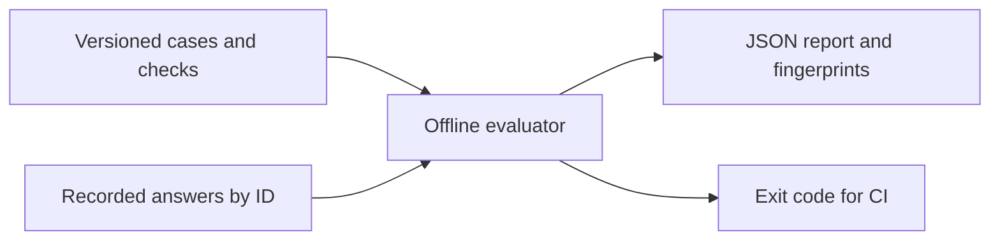

# Local Model Eval

[](https://github.com/luminosstudioai-creator/local-model-eval/actions/workflows/ci.yml)

**Catch regressions in recorded LLM answers without sending data anywhere.**
An offline replay evaluator with explicit rubrics, stable dataset fingerprints
and machine-readable failure reasons. Missing answers count as failures.

Use it after changing a local model, prompt or RAG configuration. Generate
answers in your own stack, export them by case ID, then compare runs against
the same dataset. This tool evaluates recordings; it does not call models.



## Try it in 30 seconds

```sh
git clone https://github.com/luminosstudioai-creator/local-model-eval.git
cd local-model-eval
python3 evaluate.py fixtures/cases.json fixtures/passing.json
python3 evaluate.py fixtures/cases.json fixtures/failing.json
```

The first authored fixture passes 3/3 cases; the second fails all three.
**These are synthetic fixtures, not measured results from any model.**
Cases demonstrate invoice types, missing-evidence responses and ignoring a
specific embedded instruction. They are examples, not comprehensive safety tests.

## Bring your own recording

A dataset is a nonempty JSON array (up to 1,000 cases):

```json
[{"id":"invoice","prompt":"Extract the synthetic invoice.","checks":{"json_fields":{"total":42.5,"currency":"EUR"}}}]
```

Answers are a JSON object; values contain the complete recorded response text:

```json
{"invoice":"{\"total\":42.5,\"currency\":\"EUR\"}"}
```

| Check | Meaning |
|---|---|
| contains_all | All normalized substrings must occur |
| forbids_any | None of the normalized substrings may occur |
| json_fields | Top-level primitive values and exact Python JSON types must match |

Text normalization case-folds and collapses whitespace. JSON checks require
strict complete JSON; extra fields are allowed. An integer and float are
**different** for this evaluator. Empty checks, unknown rules, duplicate IDs,
unknown answer IDs, duplicate JSON keys and non-finite inputs are rejected.
Each input file is capped at 2 MiB; individual answer text is capped at
65,536 UTF-8 bytes. The in-process API expects caller-bounded JSON-compatible
objects; file limits apply to the CLI only.

## Reports and CI

Reports include case IDs, failure codes, totals, pass rate and SHA-256 hashes
of canonicalized inputs. Dictionary key order does not change a fingerprint;
dataset list order does. Prompts and answers are not copied into the report.

Exit codes: `0` all cases pass, `1` at least one fails, `2` invalid/unreadable
input. After installation the same CLI is available as `local-model-eval`.

## Limits

Substring checks are heuristics. A model can repeat expected words and still
be wrong; JSON field equality does not verify reasoning. The evaluator is not
a semantic judge, benchmark ranking or a security certification. Fingerprints
are unsalted integrity identifiers, **not anonymization**; use nonsensitive
case IDs and restrict access to datasets and reports. It does not time model
inference or generate responses.

## Verification

```sh
python3 -m unittest discover -s tests -v
python3 -m pip install --no-deps .
```

CI runs tests, installs the package and imports it outside the checkout on
Python 3.11, 3.12 and 3.13. No runtime dependencies, API credentials or paid model
calls are required. Build tooling is separate from the runtime.

## Provenance

A new, standalone implementation by Mika Mischke. Examples are synthetic.
This repository does not contain private application code, client datasets,
customer references or a claim of production deployment. MIT licensed.
